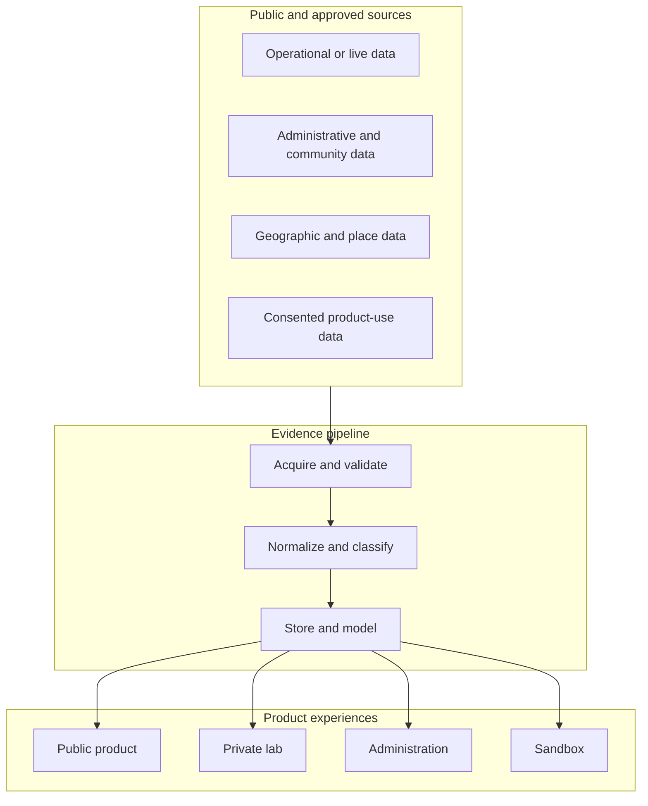
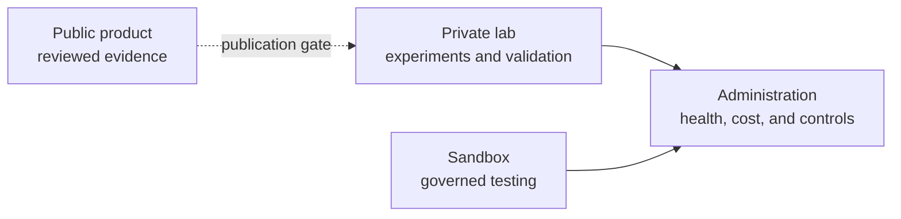
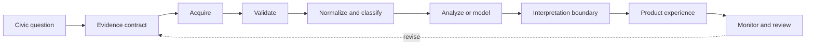
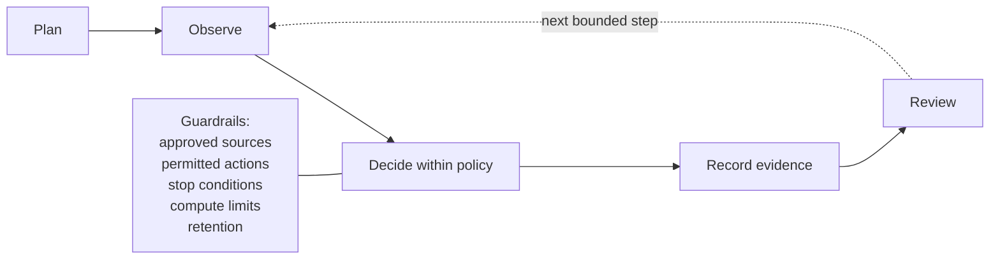
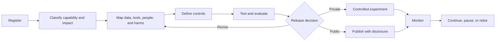
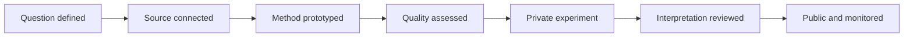

# Architecture Diagrams

The diagrams use Mermaid so they remain readable, editable, and render directly on GitHub.

## Platform context

## Trust boundaries

## Evidence lifecycle

## Bounded agent loop

## AI governance lifecycle

## Publication maturity

These diagrams describe conceptual responsibilities. They intentionally exclude product credentials, internal endpoints, production schemas, infrastructure identifiers, and exploitable operational detail.
