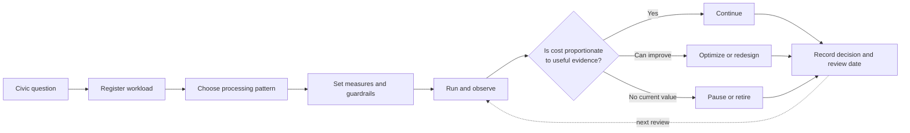

# Fictional Example: Cost Governance in Practice

This example shows how a fictional civic-data team applies cost and capacity governance to a recurring transit-access workload. It does not describe a real platform, provider account, bill, schedule, or production configuration.

## Civic question

Can residents see whether scheduled access to frequent transit has changed since the previous published period?

## Proposed workload

The team proposes collecting a published transit schedule, validating it, calculating grouped access measures, and preparing static public evidence.

## At a glance

The team is governing one workload, not the provider bill as a whole. It follows the evidence from its civic purpose to an explicit continue, change, pause, or retirement decision.

## Registration

| Workload field | Fictional entry |
| --- | --- |
| Name | Frequent-access evidence refresh |
| Owner | Civic evidence team |
| Evidence output | Dated, grouped access estimates |
| Intended users | Residents, community organizations, and public-interest researchers |
| Initial processing pattern | Scheduled preparation with static publication |
| Freshness need | Match meaningful schedule changes rather than public page views |
| Failure behaviour | Preserve the last valid result with its source date and show that a refresh failed |

## Initial design decision

The team rejects request-time calculation because every visitor would trigger substantially similar source retrieval and geospatial work. It also rejects a persistent worker because the evidence does not require continuous processing.

The selected design is:

1. Retrieve the source on a bounded schedule.
2. Validate source identity, coverage, and change state.
3. Stop when the valid source has not changed.
4. Recalculate only affected evidence when practical.
5. Publish reusable static artifacts.
6. Retain detailed intermediate records only for the documented validation period.

## Cost model

The team records categories rather than private provider details.

| Category | Cost driver | Unit measure | Evidence type |
| --- | --- | --- | --- |
| Collection | Source requests and execution duration | Cost per successful collection | Provider-reported and allocated |
| Preparation | Records and geospatial calculations | Cost per completed batch | Estimated, then allocated |
| Storage | Prepared evidence and temporary validation records | Cost per retained dataset-month | Provider-reported and allocated |
| Publication | Build and artifact delivery | Cost per published update | Allocated |
| Observability | Events and retained diagnostic records | Events per successful run | Provider-reported usage |
| Maintenance | Review and incident effort | Maintainer time per review period | Estimated |

## Guardrails

The workload card records these non-sensitive controls:

- collection cadence follows expected source change;
- unchanged valid sources do not trigger full preparation;
- execution, retries, and diagnostic retention are bounded;
- detailed intermediate evidence has an expiry rule;
- public delivery does not call the upstream source;
- the workload can be paused while the last valid dated evidence remains available; and
- source failure is shown as unavailable or stale, never interpreted as zero access.

## Review and improve

### 1. Observe

The team reviews successful runs, changed outputs, execution duration, retained data, observability volume, public use, and evidence-quality failures.

### 2. Assess

Many collection runs detect no source change. Public use is stable, but routine intermediate steps create events that do not help diagnose failures.

### 3. Decide

The team chooses to optimize the workload rather than increase its budget, move providers, or reduce evidence quality. It approves three bounded changes:

1. Check source metadata before downloading and processing the full dataset.
2. Reduce routine event detail while preserving errors, validation outcomes, and audit evidence.
3. Shorten retention for reproducible intermediate files while keeping published evidence and decision records.

### 4. Change

The changes are tested privately, approved by the workload and data owners, and released with rollback instructions. No civic measure or public interpretation is changed.

### 5. Record

The workload card records the original baseline, evidence classifications, approved changes, limitations, review date, and observed result. The next review will compare successful published updates, unit cost, quality, and freshness with the previous period.

## Decision

The workload continues because it supports a clear civic question and its recurring burden is proportionate after optimization. The review does not publish invoice totals, provider identifiers, credentials, traffic volumes, exact schedules, or production topology.

## What this example demonstrates

- Cost is evaluated at workload level rather than only by provider total.
- Freshness follows evidence need instead of the fastest available cadence.
- Static publication prevents public traffic from multiplying data-processing cost.
- Optimization preserves evidence meaning and failure transparency.
- Pause and retirement remain valid architectural outcomes.

