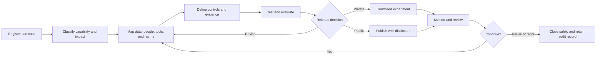

# AI and Agent Governance

AI governance should be proportional to purpose, autonomy, data sensitivity, and potential impact. A bounded research agent that cannot affect a person's rights does not need the same controls as an automated decision system determining access to a public service. Both still need an owner, a defined purpose, tested boundaries, and an accountable lifecycle.

This chapter adapts recognized AI risk-management ideas into a practical civic product workflow. It does not establish regulatory compliance or certification.

## 1. Determine what is being governed

Do not use "AI" as a catch-all label. Classify the capability first.

| Capability | Description | Typical governance focus |
| --- | --- | --- |
| Deterministic automation | Fixed rules produce repeatable outputs | Rule ownership, testing, change control, data quality |
| Statistical or machine-learning model | A fitted model produces a score, classification, estimate, or forecast | Training data, performance, drift, fairness, uncertainty |
| Generative AI feature | A foundation model generates or transforms content | Grounding, hallucination, content safety, disclosure, evaluation |
| Bounded agent | A system observes state and chooses among permitted actions | Tool access, action limits, state transitions, stop conditions, auditability |
| Automated decision system | A system makes or materially supports a decision affecting a person or service | Impact assessment, legal authority, human review, recourse, monitoring |

A product may contain more than one type. Govern each component according to its actual role.

## 2. Risk tiers

The tier determines review depth, not whether governance applies.

### Tier 0: No AI or model

Deterministic presentation or calculation with no learned or generative component.

Minimum controls:

- Named owner
- Data and rule definitions
- Quality checks
- Change history

### Tier 1: Assistive, low-impact

The system drafts, summarizes, organizes, or explores information. A person decides whether to use the output, and the output does not affect rights or service eligibility.

Additional controls:

- Clear AI disclosure where people interact with the feature
- Grounding and accuracy evaluation
- Prohibited-use statement
- Human review before publication when appropriate

### Tier 2: Bounded model or agent

The system makes choices inside an approved action set or produces analytical outputs used for research and planning. It cannot independently make consequential decisions about a person.

Additional controls:

- Approved tools and sources
- Permitted and prohibited actions
- Compute, time, and retry limits
- State-transition and event logs
- Failure and stop conditions
- Versioned policy and model records
- Periodic outcome review

### Tier 3: Consequential recommendation

The output may materially influence resource allocation, prioritization, enforcement, access, or another decision affecting communities or individuals.

Additional controls:

- Formal impact assessment
- Multidisciplinary review
- Fairness and disparate-impact evaluation
- Documented human decision authority
- Challenge and correction process
- Independent validation proportionate to impact

### Tier 4: Automated consequential decision

The system makes or executes a decision that may affect rights, benefits, safety, eligibility, or access to a public service.

This tier requires legal, policy, privacy, security, accessibility, and domain review outside this framework. Applicable law and organizational policy take precedence. A formal algorithmic impact assessment and meaningful recourse may be required.

## 3. Governance lifecycle

## 4. Required governance record

Every AI or agent capability should have one durable record containing:

### Purpose and accountability

- Civic or organizational purpose
- Intended users and affected groups
- Named product, data, model, and operational owners
- Decision authority and escalation path
- Prohibited uses

### Data and evidence

- Approved sources and classifications
- Data provenance, licence, coverage, and quality
- Personal or sensitive information assessment
- Retention and deletion rules
- Evidence class of every published output

### Model or agent definition

- Capability type and risk tier
- Model, prompt, rule, tool, and policy versions
- Allowed tools, actions, and destinations
- Autonomy boundary
- Human oversight points
- Compute, time, retry, and spend limits
- Stop and rollback conditions

### Evaluation

- Accuracy, reliability, groundedness, or task-success measures
- Known limitations and unmeasured risks
- Fairness or community-impact review where relevant
- Adversarial, misuse, and failure testing
- Acceptance thresholds and test evidence

### Transparency and recourse

- User disclosure
- Plain-language capabilities and limitations
- Explanation appropriate to the context
- Feedback, correction, or challenge process
- Public-claim boundary

### Operations

- Monitoring and incident triggers
- Audit and event records
- Source, model, and behavior drift checks
- Review frequency
- Pause, containment, and retirement process

## 5. Bounded-agent controls

A bounded agent should never receive open-ended authority merely because its objective is narrow.

At minimum, define:

- **Source allowlist:** information the agent may retrieve
- **Tool allowlist:** functions or systems the agent may call
- **Action allowlist:** decisions the agent may make without approval
- **Data boundary:** records the agent may read, write, and retain
- **Geographic and temporal boundary:** where and when it may act
- **Budget boundary:** maximum compute, requests, tokens, duration, or spend
- **State machine:** valid states and transitions
- **Evidence rule:** what must be observed before a transition is accepted
- **Stop rule:** conditions that pause or end the run
- **Human escalation:** conditions requiring review
- **Audit record:** inputs, actions, evidence, outputs, errors, and policy version

## 6. Human oversight

Human involvement must be meaningful, not ceremonial.

Document:

- What the person is expected to review
- What information they receive
- Whether they have time and authority to intervene
- What happens when they disagree with the system
- How overrides and corrections are recorded
- When fully autonomous operation is prohibited

If manual pre-approval is impractical for every low-impact run, use preventative controls, automated validation, exception alerts, sampling, retrospective review, and an immediate pause mechanism.

## 7. Evaluation and monitoring

Evaluation should match the capability.

| Capability | Example measures |
| --- | --- |
| Deterministic automation | Rule coverage, regression tests, exception rate |
| Predictive model | Error, calibration, stability, subgroup performance, drift |
| Generative feature | Groundedness, factuality, refusal quality, unsafe-output rate |
| Bounded agent | Task completion, invalid transitions, tool errors, policy violations, cost per run |
| Consequential system | Outcome quality, disparate impact, human overrides, appeals, incidents |

Monitoring should detect changes in source data, model behavior, tool availability, cost, public interpretation, and affected-community outcomes.

## 8. Incidents, pause, and retirement

Define incident conditions before release. Examples include:

- Unauthorized data access or disclosure
- Use of an unapproved source or tool
- Repeated unsupported outputs
- A failed safeguard or invalid action
- Material quality or fairness degradation
- Cost or request volume outside approved limits
- A change in purpose or scope without review

The owner must be able to pause the capability, preserve evidence, communicate the issue, correct or roll back the system, and decide whether it should resume or be retired.

## 9. Minimum public disclosure

Where AI or an agent is visible to users, explain:

- That AI or automated reasoning is involved
- The purpose of the capability
- Whether the output is observed, estimated, or modeled
- The main data categories used
- The autonomy and human-oversight boundary
- Important limitations
- How to report a problem or challenge an outcome

Do not present a simulated person as a real resident or a model output as an observed event.

## 10. Framework alignment

This governance approach is informed by the lifecycle and risk-management concepts in the NIST AI RMF, ISO/IEC 42001, OECD AI Principles, Government of Canada Algorithmic Impact Assessment, and Microsoft Responsible AI Standard. See the [Standards and Reference Framework Crosswalk](standards-crosswalk.md).

Alignment does not mean certification, conformity, endorsement, or complete implementation of any referenced framework.
