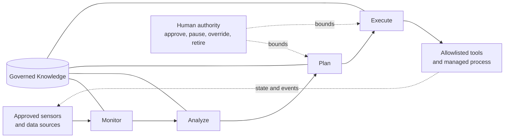

# MAPE-K Bounded Operational Loop

MAPE-K is a reference control-loop model associated with IBM's autonomic-computing architecture. It separates runtime management into **Monitor, Analyze, Plan, and Execute**, supported by shared **Knowledge**.

This framework uses MAPE-K to organize how a bounded agent responds to changing conditions. It does not use MAPE-K as a claim that an agent is fully autonomous, self-governing, or safe by default.

## 1. Why it is useful here

A civic or public-interest agent may need to observe a changing environment, determine whether evidence supports a state change, choose among permitted actions, and record what happened. MAPE-K makes those responsibilities visible and testable instead of hiding them inside one opaque agent step.

## 2. Framework mapping

| MAPE-K function | Responsibility in this framework | Required evidence or control |
| --- | --- | --- |
| Monitor | Collect approved observations, source health, current state, and relevant events | Source allowlist, timestamps, freshness, provenance, quality status, privacy boundary |
| Analyze | Validate observations, identify supported conditions, estimate uncertainty, and distinguish absence from missing data | Validation rules, semantic definitions, confidence or quality measures, failure classification |
| Plan | Select a permitted next step that serves the registered purpose | Action allowlist, policy version, risk tier, budget, time and retry limits, stop and escalation rules |
| Execute | Invoke an approved tool or state transition and capture its outcome | Authorization, input validation, idempotency where needed, result and error logging, rollback or containment |
| Knowledge | Preserve the governed context used by every stage | Evidence and state, policies, models, versions, limits, decisions, audit history, retention rules |

## 3. The governance boundary

MAPE-K describes a runtime feedback loop. It does not answer whether the system should exist, whether its purpose is lawful or proportionate, whether its impact is acceptable, or whether an output is ready for public use.

Place these controls around the loop:

- Registered purpose and named accountability
- Capability and impact classification
- Approved data, tools, and actions
- Privacy, security, accessibility, and community-impact review
- Human approval points and override authority
- Publication gates and disclosure requirements
- Compute, duration, retry, and spending limits
- Immediate pause, containment, rollback, and retirement mechanisms

For a low-impact bounded agent, a human may not approve every individual step. Preventative policy controls, automated validation, exception alerts, sampled review, and a reliable pause mechanism can provide proportionate oversight.

## 4. Example: representative transit journey

The following example illustrates the pattern without describing production implementation details.

| Stage | Example |
| --- | --- |
| Monitor | Receive an approved vehicle observation, stop reference, scheduled trip context, and source-health status |
| Analyze | Determine whether the observation is fresh, compatible with the route and stop, and sufficient to support the next state |
| Plan | Choose to continue waiting, accept a supported boarding transition, take an approved alternative, or end the run |
| Execute | Record the permitted state transition and its evidence; do not control or contact the transit vehicle |
| Knowledge | Retain the journey state, evidence references, policy version, limits, decisions, errors, and audit record |

The agent is an analytical representation. It must not be presented as a real resident, a real passenger count, or proof of what every rider experienced.

## 5. Relationship to AI governance

MAPE-K and AI governance solve different but complementary problems:

- **MAPE-K** structures the operational feedback loop.
- **AI governance** establishes purpose, accountability, risk controls, evaluation, human authority, disclosure, incident handling, and retirement.
- **Evidence governance** determines what each input and output means, where it came from, and what can responsibly be claimed.
- **Architecture governance** determines system boundaries, dependencies, trust zones, and change control.

Using MAPE-K does not imply compliance with an AI standard, endorsement by IBM, or formal implementation of IBM's complete autonomic-computing architecture.

## 6. Source documentation

- [IBM Research: An architectural approach to autonomic computing](https://research.ibm.com/publications/an-architectural-approach-to-autonomic-computing)
- [IBM Redbooks: Problem Determination Using Self-Managing Autonomic Technology](https://www.redbooks.ibm.com/redbooks/pdfs/sg246665.pdf), including its description of the MAPE-K intelligent control loop

These sources should be consulted for the original architecture and terminology. This page is a civic-evidence adaptation, not a reproduction of IBM documentation.
